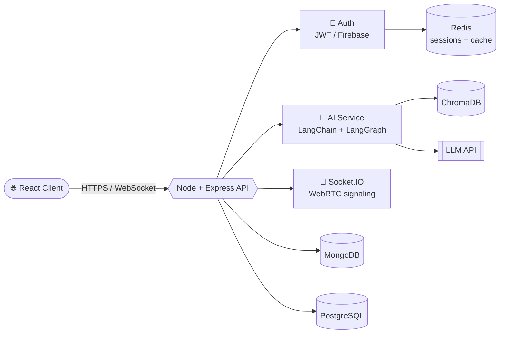

<div align="center">


</div>

---

## 🚀 Featured Projects

<div align="center">


<a href="https://cmai-self.vercel.app"></a>
<a href="https://lingolive.onrender.com"></a>
</div>

---

## 💼 Experience & Education

| | |
|---|---|
| **Frontend Developer Intern** · Beritrave Technology Pvt Ltd <br/> `Jun 2026 – Sep 2026` · Remote, Indore | Built **4 React.js admin workflows** (user/driver management, KYC verification, availability tracking, profile admin) and integrated **REST APIs** with Node.js services across all 4 modules. Designed reusable **Tailwind** components in **5 categories** (tables, forms, filters, modals, status indicators). Contributed to **6 projects** and independently built **3**. |
| **B.Tech, Computer Science Engineering** <br/> `2023 – 2027` · Jagannath University | CGPA **7.8 / 10** · strong foundation in DSA, OOP and DBMS |
| 🏆 **National Level Winner, Smart India Hackathon 2025** | Won among **500+ teams** with a **UGC–AICTE approval automation platform**: role-based access control, document validation and real-time status tracking. |

---

## 🧠 How I Think About Architecture



## 🎯 Current Missions

```diff
+ Shipping full-stack products with React, Node.js & MongoDB
+ Designing RAG + agentic workflows with LangChain & LangGraph
+ Sharpening DSA and System Design every single week
+ Exploring performance: caching, rate limiting, indexing
- Tutorial hell (retired permanently)
```

---

<div align="center">


<a href="https://www.linkedin.com/in/chandermanimishra/"></a>
<a href="https://github.com/Chandermani-web"></a>
<a href="mailto:chandermanimishra91@gmail.com"></a>
<a href="https://wa.me/918607653657"></a>
<a href="https://x.com/Chandermani47595"></a>

<br/><br/>


<picture>
  <source media="(prefers-color-scheme: dark)" srcset="https://raw.githubusercontent.com/Chandermani-web/Chandermani-web/output/github-snake-dark.svg" />
  
</picture>

**⭐ If something here inspired you, drop a star and follow, and let's ship something great.**

</div>

