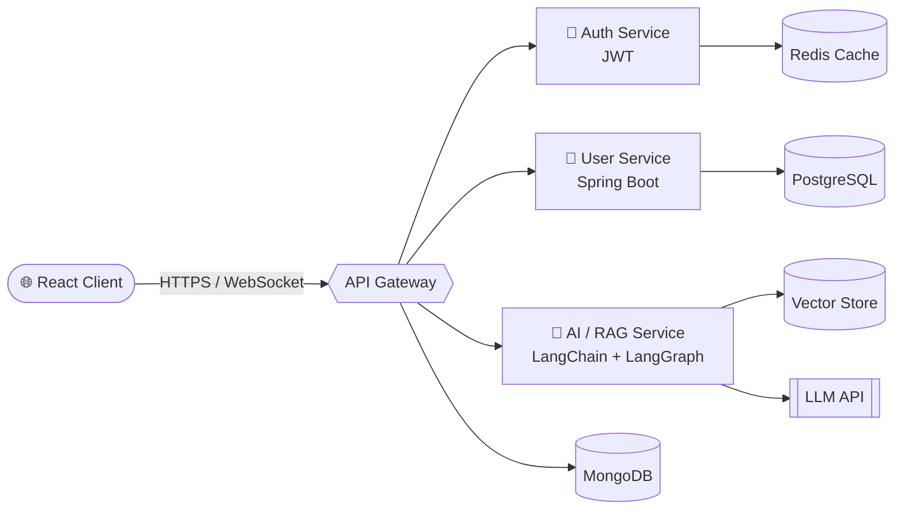

<!-- ═══════════════════════════ HERO ═══════════════════════════ -->
<div align="center">

</div>

<table>
<tr>
<td width="58%" valign="middle">

<sub>`FULL-STACK ENGINEER` &nbsp;·&nbsp; `BACKEND-FOCUSED` &nbsp;·&nbsp; `GENAI BUILDER`</sub>

<br/>

### 👋 Hi there, I'm

# CHANDERMANI<br/>MISHRA

### 🔹 **BUILD. BEYOND.**


<br/>


</td>
<td width="42%" align="center" valign="middle">


<br/>

`▰▰▰ ENGINEER / BUILDER`

</td>
</tr>
</table>

<div align="center">


</div>

---

<!-- ═══════════════════════ 01 + 02 ═══════════════════════ -->
<table>
<tr>
<td width="50%" valign="top">

<sub>`01 / FROM THOUGHT TO THING`</sub>

## IDEAS. BUILT DIFFERENT.

```js
// github.com / Chandermani-web / build
> turn_curiosity_into_impact()

  [01 CREATE] ──▶ [02 ENGINEER] ──▶ [03 SHIP]
```

**🌐 Modern Web & App Dev**
<br/><sub>From first interaction to production.</sub>

**☁️ AI & Cloud Integration**
<br/><sub>Scalable systems. Useful intelligence.</sub>

**🏗️ Backend & Microservices**
<br/><sub>Clean APIs, solid auth, smart caching.</sub>

**🤝 Community & Collaboration**
<br/><sub>Hackathons, open source, learning in public.</sub>

</td>
<td width="50%" valign="top">

<sub>`02 / LIFE OUTSIDE THE COMMIT`</sub>

## MORE THAN A JOB TITLE.

```python
problem.solve()

approach   = "Understand → simplify"
complexity = "Think before you type"
result     = "All tests passed ✅"
```

### 🧮 Competitive Programming & DSA
<sub>`CHASE THE ELEGANT SOLUTION.`</sub>

For the joy of a problem, solved.

### 🧠 Currently Learning
`System Design` · `Distributed Systems` · `Agentic AI Workflows`

</td>
</tr>
</table>

---

<!-- ═══════════════════════ 03 ENGINE ROOM ═══════════════════════ -->
<sub>`03 / MY ENGINE ROOM`</sub>

## TOOLS CHANGE. CURIOSITY DOESN'T.

<sub>`LANGUAGES / SYSTEMS / INTELLIGENCE`</sub>

<table>
<tr>
<td width="22%"><b>01 · LANGUAGES</b></td>
<td>

</td>
</tr>
<tr>
<td><b>02 · FRONTEND & RUNTIME</b></td>
<td>

</td>
</tr>
<tr>
<td><b>03 · BACKEND</b></td>
<td>

</td>
</tr>
<tr>
<td><b>04 · DATA & CACHE</b></td>
<td>

</td>
</tr>
<tr>
<td><b>05 · CLOUD & DEVOPS</b></td>
<td>

</td>
</tr>
<tr>
<td><b>06 · AI & REAL-TIME</b></td>
<td>


</td>
</tr>
</table>

### 🧠 How I think about architecture



---

<!-- ═══════════════════════ 04 CREDENTIALS ═══════════════════════ -->
<sub>`04 / BUILDER CREDENTIALS`</sub>

## REAL WORK. REAL IMPACT.

<table>
<tr>
<td width="34%" align="center" valign="top">

<sub>`05 / BUILDER PASS`</sub>


### CHANDERMANI MISHRA
<sub>`INDIA · INDEPENDENT CREATOR`</sub>

`▌▌▎▌▎▌▌▎▌▌▎▌▎▌▌▎▌`

**THE HUMAN BEHIND THE CODE.**

</td>
<td width="66%" valign="top">

<sub>`PUBLIC SNAPSHOT`</sub>


<sub>`MOST-STARRED / PUBLIC REPOSITORIES`</sub>

<!-- 👇 Replace repo=... with your real repository names -->
<a href="https://github.com/Chandermani-web/YOUR-REPO-1"></a>
<a href="https://github.com/Chandermani-web/YOUR-REPO-2"></a>
<a href="https://github.com/Chandermani-web/YOUR-REPO-3"></a>
<a href="https://github.com/Chandermani-web/YOUR-REPO-4"></a>

</td>
</tr>
</table>

<div align="center">


</div>

---

<!-- ═══════════════════════ FEATURED PROJECTS ═══════════════════════ -->
## 🔥 Featured Projects

<!-- 👇 Replace with your real projects -->
| Project | What it does | Stack | Links |
|---|---|---|---|
| 🧩 **Project One** | One-line pitch: the problem it solves and for whom | `Spring Boot` `PostgreSQL` `Redis` | [Repo](#) · [Live](#) |
| 🤖 **Project Two (GenAI)** | RAG-based assistant that answers from your own documents | `LangChain` `LangGraph` `React` | [Repo](#) · [Live](#) |
| 💬 **Project Three (Real-time)** | Live chat / video using WebSocket + WebRTC | `Node.js` `WebRTC` `Socket` | [Repo](#) · [Live](#) |

---

## 🎯 Current Missions

```diff
+ Building production-grade backends with Spring Boot & Node.js
+ Designing RAG + agentic workflows with LangChain & LangGraph
+ Sharpening DSA and System Design every single week
+ Exploring performance: caching, indexing, and API optimization
- Tutorial hell (retired permanently)
```

---

<!-- ═══════════════════════ 06 CONTACT ═══════════════════════ -->
<div align="center">

<sub>`06 / START A CONVERSATION`</sub>

## LET'S BUILD SOMETHING GREAT.

Ideas. Opportunities. Your next move.<br/>
Open to **hackathons**, **full-stack projects**, **open source** and **collaboration**.

<br/>

<a href="http://www.linkedin.com/in/chandermani-mishra-a25473304"></a>
<a href="https://x.com/Chandermani47595"></a>
<a href="mailto:chandermanimishra91@gmail.com"></a>
<a href="https://wa.me/918607653657"></a>
<a href="https://www.instagram.com/owlh.imanshu/"></a>

<br/><br/>

<picture>
  <source media="(prefers-color-scheme: dark)" srcset="https://raw.githubusercontent.com/Chandermani-web/Chandermani-web/output/github-snake-dark.svg" />
  
</picture>

<br/>

**⭐ If something here inspired you, drop a star and follow, and let's ship something great.**

</div>


