<div align="center">










<br/>


</div>

---

## 🔥 Most-Starred / Featured Repositories

<!-- 👇 Replace YOUR-REPO-N with your real repository names -->
<div align="center">
<a href="https://github.com/Chandermani-web/YOUR-REPO-1"></a>
<a href="https://github.com/Chandermani-web/YOUR-REPO-2"></a>
<a href="https://github.com/Chandermani-web/YOUR-REPO-3"></a>
<a href="https://github.com/Chandermani-web/YOUR-REPO-4"></a>
</div>

---

## 🧠 How I Think About Architecture


## 🎯 Current Missions

```diff
+ Building production-grade backends with Spring Boot & Node.js
+ Designing RAG + agentic workflows with LangChain & LangGraph
+ Sharpening DSA and System Design every single week
+ Exploring performance: caching, indexing, and API optimization
- Tutorial hell (retired permanently)
```

---

<div align="center">


<a href="http://www.linkedin.com/in/chandermani-mishra-a25473304"></a>
<a href="https://x.com/Chandermani47595"></a>
<a href="mailto:chandermanimishra91@gmail.com"></a>
<a href="https://wa.me/918607653657"></a>
<a href="https://www.instagram.com/owlh.imanshu/"></a>

<br/><br/>

<picture>
  <source media="(prefers-color-scheme: dark)" srcset="https://raw.githubusercontent.com/Chandermani-web/Chandermani-web/output/github-snake-dark.svg" />
  
</picture>

**⭐ If something here inspired you, drop a star and follow, and let's ship something great.**

</div>


