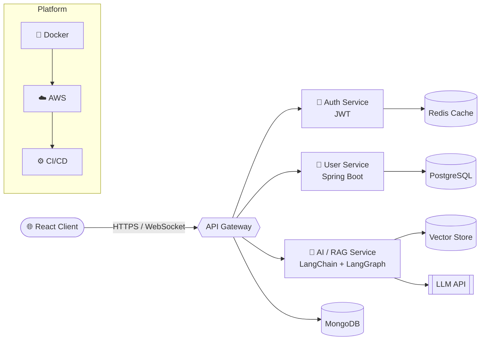

<!-- ═══════════════════════════ HEADER ═══════════════════════════ -->
<div align="center">


<a href="https://git.io/typing-svg">
  
</a>

<br/><br/>


</div>

---

## 🖥️ `~/about.sh`

```bash
$ cat chandermani.json
```

```json
{
  "name": "Chandermani Mishra",
  "role": "Full-Stack Developer · Backend-Focused · GenAI Explorer",
  "languages": ["Java", "JavaScript", "SQL"],
  "backend": ["Spring Boot", "Hibernate", "Node.js", "Express.js", "Microservices", "API Gateway"],
  "frontend": ["React.js", "Redux", "Tailwind CSS", "HTML", "CSS"],
  "genAI": ["LangChain", "LangGraph", "RAG", "LLM APIs"],
  "realtime": ["WebSocket", "WebRTC"],
  "data": ["PostgreSQL", "MongoDB", "Redis", "Caching"],
  "devOps": ["Docker", "AWS", "CI/CD", "Git"],
  "cs_core": ["DSA", "OOP", "DBMS", "OS", "Computer Networks"],
  "philosophy": "Execution beats theory. Build it, break it, fix it, ship it.",
  "currentlyLearning": ["System Design", "Distributed Systems", "Agentic AI Workflows"],
  "openTo": ["Hackathons", "Open Source", "Full-Stack Projects", "Collaboration"],
  "funFact": "I learn by building real products, not by collecting tutorials. 🛠️"
}
```

---

## ⚡ What I Do

<table>
<tr>
<td width="50%" valign="top">

### 🏗️ Backend & Systems
Designing **REST APIs**, **microservices**, and **API gateways** with **Spring Boot** and **Node/Express** — with solid auth, caching strategies, and clean data models behind them.

</td>
<td width="50%" valign="top">

### 🤖 GenAI Engineering
Building **RAG pipelines** and **agent workflows** with **LangChain** and **LangGraph**, wiring **LLM APIs** into real products — not just demos.

</td>
</tr>
<tr>
<td width="50%" valign="top">

### 🔴 Real-Time Apps
Shipping live experiences with **WebSocket** and **WebRTC** — chat, presence, streaming, and peer-to-peer features.

</td>
<td width="50%" valign="top">

### ☁️ Cloud & Delivery
Containerizing with **Docker**, deploying on **AWS**, and automating with **CI/CD** so code goes from commit to production confidently.

</td>
</tr>
</table>

---

## 🧰 Tech Arsenal

### 🔹 Languages
<p>
  
</p>

### 🔹 Backend & Frameworks
<p>
  
</p>

### 🔹 Frontend
<p>
  
</p>

### 🔹 Databases & Caching
<p>
  
</p>

### 🔹 DevOps & Cloud
<p>
  
</p>

### 🔹 GenAI, Real-Time & Architecture
<p>
  
  
  
  
  
  
  
  
  
  
</p>

---

## 🧠 How I Think About Architecture

> A peek at the kind of systems I love designing: an AI-powered, microservice-based backend.



---

## 🔥 Featured Projects

<!-- 👇 Replace each block with your real projects: name, one-line pitch, stack, and links -->

| Project | What it does | Stack | Links |
|---|---|---|---|
| 🧩 **Project One** | One-line pitch: the problem it solves and for whom | `Spring Boot` `PostgreSQL` `Redis` | [Repo](#) · [Live](#) |
| 🤖 **Project Two (GenAI)** | RAG-based assistant that answers from your own documents | `LangChain` `LangGraph` `React` | [Repo](#) · [Live](#) |
| 💬 **Project Three (Real-time)** | Live chat / video using WebSocket + WebRTC | `Node.js` `WebRTC` `Socket` | [Repo](#) · [Live](#) |

---

## 🎯 Current Missions

```diff
+ Building production-grade backends with Spring Boot & Node.js
+ Designing RAG + agentic workflows with LangChain & LangGraph
+ Sharpening DSA and System Design every single week
+ Exploring performance: caching, indexing, and API optimization
- Tutorial hell (retired permanently)
```

<div align="center">

| 🏗️ Backend Systems | ⚡ Performance | 🤖 Generative AI | 🧮 DSA & System Design |
|:---:|:---:|:---:|:---:|
| Scalable APIs & Microservices | Caching & Optimization | Agents, RAG, LLM Apps | Fundamentals that scale |

</div>

---

## 📊 GitHub Analytics

<div align="center">


</div>

### 🏆 Trophies

<div align="center">
  
</div>

---

## 🐍 Contribution Snake

<!--
  To enable: add the Platane/snk GitHub Action to your profile repo
  (see https://github.com/Platane/snk) and it will generate this file on a schedule.
-->
<div align="center">
  <picture>
    <source media="(prefers-color-scheme: dark)" srcset="https://raw.githubusercontent.com/Chandermani-web/Chandermani-web/output/github-snake-dark.svg" />
    
  </picture>
</div>

---

## 🤝 Let's Build Something

<div align="center">

I'm open to **hackathons**, **full-stack projects**, **open-source**, and **collaboration**.
Ask me about **Java, Spring Boot, Node.js, APIs, databases, system design, and GenAI workflows.**

<br/>

<a href="http://www.linkedin.com/in/chandermani-mishra-a25473304"></a>
<a href="https://x.com/Chandermani47595"></a>
<a href="mailto:chandermanimishra91@gmail.com"></a>
<a href="https://wa.me/918607653657"></a>
<a href="https://www.instagram.com/owlh.imanshu/"></a>

<br/><br/>


<br/>

**⭐ If something here inspired you, drop a star and follow, and let's ship something great.**

</div>


